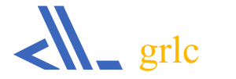

::: {.hero}
# Linking History

Linked Data tooling and research for economic, social and demographic history, developed within [CLARIAH](https://www.clariah.nl).

[Explore the tools](tools.qmd){.btn .btn-light} [See the research](research.qmd){.btn .btn-outline-light}
:::

::: {.grid}
::: {.g-col-12 .g-col-lg-8}

Did you know you can link your datasets to other datasets across the world, just as websites link to each other? The semantic web is like an internet for datasets. If you publish your data in a shared format (RDF), you can easily retrieve information from other datasets. Imagine how easily you could enrich your own data with georeferences or national statistics!

Strictly speaking, you are not linking but *querying* the data. When you convert your data to RDF, you describe it with a common vocabulary (or create your own). Because others have done the same, you can query across datasets.

**Sounds complicated? Not a techie?** No problem. That's why we built [tools](tools.qmd) to help you out.

:::
::: {.g-col-12 .g-col-lg-4}

### Questions?

Want to stay informed, follow a course, contribute data, collaborate on code or develop apps? [Contact us](contact.qmd).

:::
:::

---

::: {.grid}
::: {.g-col-12 .g-col-md-6}

## Project highlights

**Best Paper Awards**

- Best Paper at the SALAD 2016 workshop for "grlc Makes GitHub Taste Like Linked Data APIs" ([PDF](https://www.albertmeronyo.org/wp-content/uploads/2016/04/SALAD2016_paper_4.pdf))
- Best Paper at the WHiSe 2016 workshop for "An Ecosystem for Linked Humanities Data" ([PDF](https://www.albertmeronyo.org/wp-content/uploads/2016/04/WHiSe_2016_paper_4.pdf))

:::
::: {.g-col-12 .g-col-md-6}

## What people think

> "This is great! It allows me to not only share my data, but share live queries as well!"
>
> — Ivo Zandhuis, independent researcher

:::
:::

---

::: {.grid}
::: {.g-col-12 .g-col-md-7}

## In the spotlight: grlc

[grlc](https://grlc.io) makes your Linked Data accessible on the Web by automatically turning your SPARQL queries into RESTful APIs, with (almost) no effort.

- Share your queries
- Reuse the queries of others
- Make your research questions *and* answers repeatable

:::
::: {.g-col-12 .g-col-md-5}

{fig-alt="grlc logo" width="260"}

:::
:::
